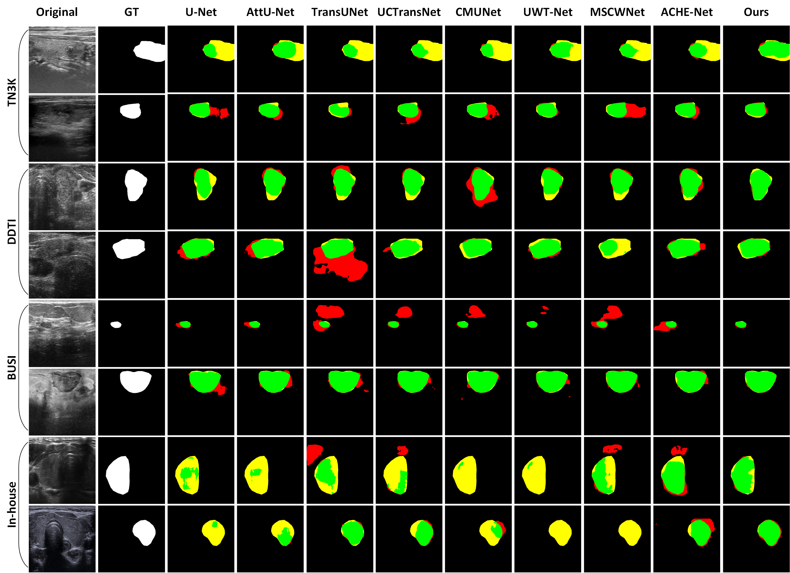

# SAFE-Mixer: A Spatial-Frequency Mutual Gating Module for Ultrasound Lesion Segmentation

## Environment

- Python 3.9.25
- PyTorch 2.0.0
- CUDA 11.8

Install dependencies:

```bash
pip install -r requirements.txt
```

## Datasets

- [TN3K](https://github.com/haifangong/TRFE-Net-for-thyroid-nodule-segmentation)
- [DDTI](https://fidopt.io/dataset/DDTI/)
- [BUSI](https://www.kaggle.com/aryashah2k/breast-ultrasound-images-dataset)

Place the datasets in `inputs/<dataset>/images/` and `inputs/<dataset>/masks/0/`.

## Training and Evaluation

```bash
python main.py --dataset TN3K --name TN3K_SAFE --img_ext .jpg --mask_ext .png --epochs 300 --batch_size 8 --split_seed 41 --num_workers 0
```

## Qualitative Results


